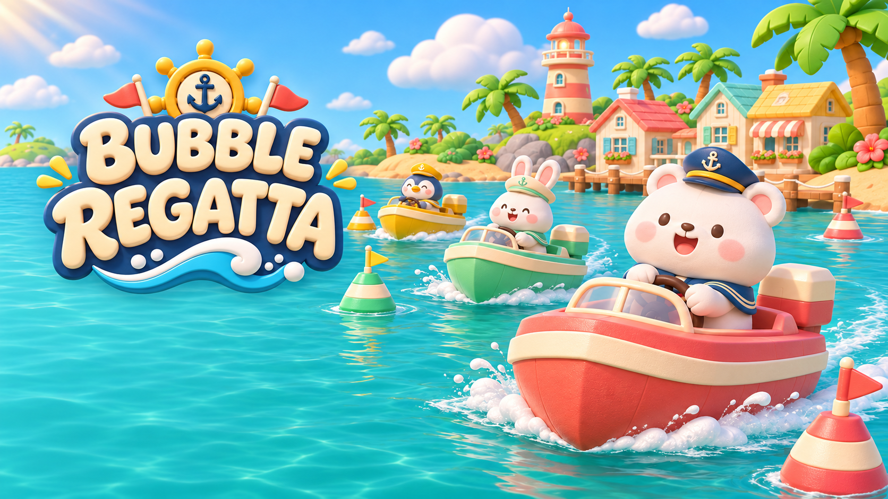

# Bubble Regatta

A cute boat racing game. Choose an animal captain, collect gifts, ride boost lanes, and race through a three-round championship.

[Play in your browser](https://eric-schecter.github.io/bubble-regatta/)

## Controls

- Arrows / WASD: drive and steer.
- Shift + steering: drift; release to boost.
- Space: use a gift.
- Esc: pause. R: restart. M: mute.

## Development

Open `project.godot` in Godot 4.7.2. Run `./tools/export_web.sh` to build the Web version. Pushes to `main` deploy to GitHub Pages.

Art is AI-generated or built by project code. Music and sound effects are generated by the included tools. Nunito uses the [SIL Open Font License](assets/fonts/OFL.txt).
